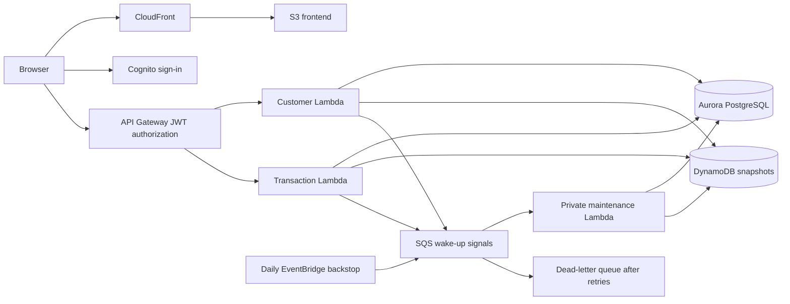

# CapitalLedger

A banking simulator with an append-only ledger, safe request retries, and versioned customer summaries. Built as an AI-assisted learning project by Bhavesh Mantrabuddi for CMSC 398P.

**Validation:** Automated checks cover financial invariants on SQLite and real PostgreSQL, HTTP behavior, AWS boundaries, recovery, and deployment guards. A reproducible Windows PostgreSQL 18.1 benchmark completed 200 deposits with 8 workers at 15.72 responses/s with p95 latency of 688.992 ms; 32 simultaneous retries committed exactly one transaction. These are local engine measurements. See the [validation record](docs/validation.md) and [PostgreSQL benchmark](docs/benchmark-postgres.md) for evidence and limits.

[Hosted demo](https://d1kg2jlznlaa11.cloudfront.net/) · [Local quickstart](START-HERE.md) · [Architecture](docs/architecture.md)

The hosted demo uses Cognito sign-in. All accounts and funds are simulated; use fictional profile details. The repository defaults to a local SQLite application that requires no AWS account or paid service.

## What it does

- Create accounts with a fictional customer name, date of birth, and opening balance.
- Deposit, withdraw, and transfer simulated USD using integer-cent amounts.
- Reject overdrafts and enforce account ownership on each operation.
- Commit balances, double-entry ledger records, retry results, and outbox events together.
- Reuse idempotency keys after uncertain responses so retries cannot move money twice.
- Synchronize versioned customer snapshots without letting stale events overwrite newer balances.
- Recover delayed snapshots through a SQL outbox, private SQS-triggered worker, and daily reconciliation backstop on AWS.
- Reproduce PostgreSQL contention tests and review an Express-compatible infrastructure plan before deploying.

## Components and responsibilities

| Component | Implementation | Responsibility |
|---|---|---|
| Browser client | JavaScript, HTML, CSS | Account dashboard, forms, saved retry keys, OAuth code flow with PKCE |
| API and ledger engine | Python | Validation, ownership, deposits, withdrawals, transfers, idempotency |
| Authoritative database | SQLite locally; Aurora PostgreSQL on AWS | Atomic balances, immutable ledger entries, transaction history, outbox |
| Customer summaries | Local SQL projection; DynamoDB on AWS | Customer profiles, versioned balance snapshots |
| Cloud entry points | Two Python Lambda functions | Separate customer and transaction routes |
| Recovery and reconciliation | SQS, private Lambda, EventBridge, DLQ | Bounded outbox replay, daily backstop, count-only reconciliation logs |
| Hosting and identity | S3, CloudFront, API Gateway, Cognito, IAM | HTTPS delivery, verified user tokens, scoped AWS service access |
| Deployment automation | CloudFormation and Python | New application stack referencing an existing IAM-enabled Aurora Express cluster |



Aurora is the authority for financial decisions. SQL changes commit before the DynamoDB snapshot is delivered, so cross-store consistency is eventual. The local server uses the same engine with SQLite and a background delivery worker.

## Run locally

Prerequisite: Python 3.11 or newer. No package installation is required for the local application.

On Windows, from the repository root:

```powershell
python start-local.py
```

On macOS/Linux:

```sh
python3 start-local.py
```

Open `http://127.0.0.1:8787`. Select Alice or Bob to use the fictional local identities. Data persists in `.local/ledger.sqlite3`, which Git ignores. To use another port, add `--port 8788`.

Local account switching and worker controls are available only on the loopback development server. The starter ignores `DATABASE_URL`; an alternate PostgreSQL database must be explicitly selected with `--postgres`.

## AWS deployment

The hosted version uses Aurora Express with IAM PostgreSQL authentication, two ARM64 Python 3.12 Lambdas, DynamoDB, API Gateway, Cognito, and a private S3 origin served through CloudFront.

The tracked `frontend/config.js` uses local defaults. For an AWS deployment, start from [config.aws.example.js](frontend/config.aws.example.js), supply your own public API and Cognito values, and use that configuration for the hosted assets. Browser configuration never contains AWS credentials or a client secret.

See [Express setup](docs/express-setup.md) and [deployment options](docs/deployment.md). `scripts/deploy-express.py` defaults to a read-only plan, checks the expected account and active Free plan, and references an existing Express cluster. It packages Linux ARM64 dependencies, deploys a new application stack, initializes the schema privately, and publishes generated frontend configuration only with `--apply`. The new full application path has been validated without creating a duplicate live application. The existing demo's maintenance addition is managed separately through `infra/operations.yaml`.

The older full-configuration SAM template uses a separate Aurora Data API path; its PowerShell script still stops on a Free plan. Neither deployment path upgrades the account plan.

## Test commands

Install the optional test and infrastructure dependencies:

```sh
python -m pip install -r requirements-dev.txt
```

On Windows:

```powershell
$env:PYTHONPATH = "$PWD\backend"
python -m unittest discover -s tests -v
node --check frontend/app.js
cfn-lint infra/template.yaml infra/express.yaml infra/operations.yaml
```

On macOS/Linux:

```sh
PYTHONPATH=backend python3 -m unittest discover -s tests -v
node --check frontend/app.js
cfn-lint infra/template.yaml infra/express.yaml infra/operations.yaml
```

Set `TEST_DATABASE_URL` only for a dedicated disposable PostgreSQL database to include the 14 database integration tests. They create and drop isolated test schemas. GitHub Actions provides PostgreSQL 17 for this suite; hosted CI results are separate from local checks.

## Development boundaries

SQLite serializes writers. PostgreSQL uses explicit transactions and row locks. Results from the local benchmark are not AWS throughput measurements.

API mutations attempt immediate snapshot delivery and send a generic SQS signal after commit. The private worker drains up to 100 outbox events, reconciles, and requests continuation for a full batch. Notification failures preserve the committed result; a configurable daily signal recovers missed notifications. AWS recursion protection remains enabled, so exceptionally large continuation chains may stop and need an independent daily/API signal or DLQ review.

Daily recovery can briefly wake auto-paused Aurora and consume Free plan credits. Queue polling, storage, logs, and requests also have usage costs. There is no minute-by-minute database polling; local mode remains available without AWS.

S3 static website configuration is enabled, while the public delivery path uses CloudFront's private S3 REST origin. Cognito authenticates browser users; IAM authorizes Lambda access to AWS resources. These are distinct responsibilities.

This project does not connect to a bank or move real money. It is an independent educational simulator with no affiliation with Capital One.

## Learning and attribution

Implemented with AI assistance. The main learning goals are SQL transaction boundaries, idempotency after lost responses, eventual consistency, version-conditional delivery, and cloud identity boundaries. The [architecture notes](docs/architecture.md) explain those tradeoffs.

The bundled public AWS trust roots are documented in [CERTIFICATES.md](backend/ledger/CERTIFICATES.md). Application dependencies and the disposable CI database are listed in their configuration files. Generated databases, deployment artifacts, credentials, recordings, and AWS account evidence are excluded from this repository.
