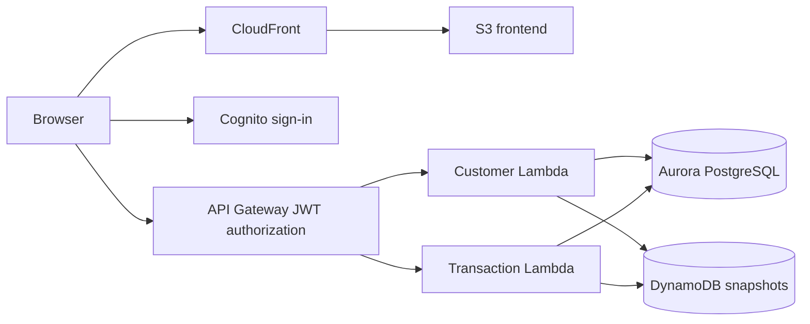

# CapitalLedger

A banking simulator with an append-only ledger, safe request retries, and versioned customer summaries. Built as an AI-assisted learning project by Bhavesh Mantrabuddi for CMSC 398P.

**Validation:** The latest local run passed 45 tests, with 14 optional PostgreSQL tests skipped because no dedicated test database was configured. The deployed AWS application was exercised through Cognito sign-in, account creation, deposits, withdrawals, persistence, and overdraft rejection; read-only Aurora and DynamoDB queries confirmed the final balance. See the [validation record](docs/validation.md) for evidence and limits.

[Hosted demo](https://d1kg2jlznlaa11.cloudfront.net/) · [Local quickstart](START-HERE.md) · [Architecture](docs/architecture.md)

The hosted demo uses Cognito sign-in. All accounts and funds are simulated; use fictional profile details. The repository defaults to a local SQLite application that requires no AWS account or paid service.

## What it does

- Create accounts with a fictional customer name, date of birth, and opening balance.
- Deposit, withdraw, and transfer simulated USD using integer-cent amounts.
- Reject overdrafts and enforce account ownership on each operation.
- Commit balances, double-entry ledger records, retry results, and outbox events together.
- Reuse idempotency keys after uncertain responses so retries cannot move money twice.
- Synchronize versioned customer snapshots without letting stale events overwrite newer balances.
- Demonstrate delayed delivery, recovery, and reconciliation in local mode.

## Components and responsibilities

| Component | Implementation | Responsibility |
|---|---|---|
| Browser client | JavaScript, HTML, CSS | Account dashboard, forms, saved retry keys, OAuth code flow with PKCE |
| API and ledger engine | Python | Validation, ownership, deposits, withdrawals, transfers, idempotency |
| Authoritative database | SQLite locally; Aurora PostgreSQL on AWS | Atomic balances, immutable ledger entries, transaction history, outbox |
| Customer summaries | Local SQL projection; DynamoDB on AWS | Customer profiles, versioned balance snapshots |
| Cloud entry points | Two Python Lambda functions | Separate customer and transaction routes |
| Hosting and identity | S3, CloudFront, API Gateway, Cognito, IAM | HTTPS delivery, verified user tokens, scoped AWS service access |
| Infrastructure reference | CloudFormation/SAM and PowerShell | Alternate full-configuration deployment, separate from the Express demo |



Aurora is the authority for financial decisions. SQL changes commit before the DynamoDB snapshot is delivered, so cross-store consistency is eventual. The local server uses the same engine with SQLite and a background delivery worker.

## Run locally

Prerequisite: Python 3.11 or newer. No package installation is required for the local application.

On Windows, from the repository root:

```powershell
python start-local.py
```

On macOS/Linux:

```sh
python3 start-local.py
```

Open `http://127.0.0.1:8787`. Select Alice or Bob to use the fictional local identities. Data persists in `.local/ledger.sqlite3`, which Git ignores. To use another port, add `--port 8788`.

Local account switching and worker controls are available only on the loopback development server. The starter ignores `DATABASE_URL`; an alternate PostgreSQL database must be explicitly selected with `--postgres`.

## AWS deployment

The hosted version uses Aurora Express with IAM PostgreSQL authentication, two ARM64 Python 3.12 Lambdas, DynamoDB, API Gateway, Cognito, and a private S3 origin served through CloudFront.

The tracked `frontend/config.js` uses local defaults. For an AWS deployment, start from [config.aws.example.js](frontend/config.aws.example.js), supply your own public API and Cognito values, and use that configuration for the hosted assets. Browser configuration never contains AWS credentials or a client secret.

See [Express setup](docs/express-setup.md) and [deployment options](docs/deployment.md). The included full-configuration template uses a different Aurora connection path and is not a one-command recreation of the Express demo. Its deployment script stops on an AWS Free plan before provisioning resources.

## Test commands

Install the optional test and infrastructure dependencies:

```sh
python -m pip install -r requirements-dev.txt
```

On Windows:

```powershell
$env:PYTHONPATH = "$PWD\backend"
python -m unittest discover -s tests -v
node --check frontend/app.js
cfn-lint infra/template.yaml
```

On macOS/Linux:

```sh
PYTHONPATH=backend python3 -m unittest discover -s tests -v
node --check frontend/app.js
cfn-lint infra/template.yaml
```

Set `TEST_DATABASE_URL` only for a dedicated disposable PostgreSQL database to include the 14 database integration tests. They create and drop isolated test schemas. GitHub Actions provides PostgreSQL 17 for this suite; hosted CI results are separate from local checks.

## Development boundaries

SQLite serializes writers. PostgreSQL uses explicit transactions and row locks. Results from the local benchmark are not AWS throughput measurements.

The live two-Lambda demo attempts immediate snapshot delivery. Durable outbox replay and reconciliation handlers are implemented, but scheduled worker and reconciliation functions are not enabled in that deployment. The local background worker supports the recovery demonstration.

S3 static website configuration is enabled, while the public delivery path uses CloudFront's private S3 REST origin. Cognito authenticates browser users; IAM authorizes Lambda access to AWS resources. These are distinct responsibilities.

This project does not connect to a bank or move real money. It is an independent educational simulator with no affiliation with Capital One.

## Learning and attribution

Implemented with AI assistance. The main learning goals are SQL transaction boundaries, idempotency after lost responses, eventual consistency, version-conditional delivery, and cloud identity boundaries. The [architecture notes](docs/architecture.md) explain those tradeoffs.

The bundled public AWS trust roots are documented in [CERTIFICATES.md](backend/ledger/CERTIFICATES.md). Application dependencies and the disposable CI database are listed in their configuration files. Generated databases, deployment artifacts, credentials, recordings, and AWS account evidence are excluded from this repository.
