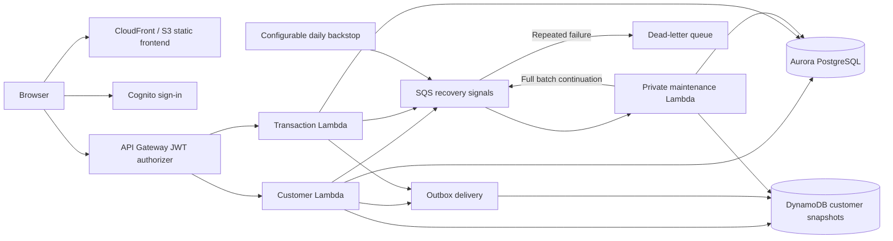

# Architecture and correctness model

Capital Ledger is an educational bank-account simulator. It has no affiliation with Capital One and never handles actual funds. All demo data is fictional. The architecture keeps the course's S3, Lambda, DynamoDB, Aurora, and IAM components while adding transactional correctness and recovery behavior.

## Components

The October 31 demonstration originally used Aurora Express with the IAM PostgreSQL connector and two HTTP Lambdas. The recovery extension in `infra/operations.yaml` adds the private SQS-driven maintenance path shown above to an existing deployment. `infra/express.yaml` includes that support stack when provisioning a new application against an existing Express database. Deployment status and live evidence are recorded separately in [validation](validation.md); the complete new Express stack has been validated but has not been deployed from scratch.

The repository also supports a local HTTP server, development identities, and an on-disk development database. Local mode is for running the same financial behavior without an AWS account. It does not simulate IAM, Cognito, Lambda invocation, or AWS network behavior. PostgreSQL tests are necessary to exercise PostgreSQL transaction semantics; SQLite tests alone are insufficient evidence for Aurora concurrency behavior.

## Data model

- **Accounts:** owner subject, fictional profile fields, current integer-cent balance, currency, and increasing version.
- **Transactions:** immutable operation identity and metadata. Opening balances, deposits, withdrawals, and transfers are recorded explicitly.
- **Ledger entries:** signed account movements associated with a transaction. Transfers have equal and opposite entries. External demo funding is represented by a designated funding account.
- **Idempotency records:** caller-scoped key, request fingerprint, and serialized successful result, committed alongside the operation.
- **Outbox events:** account snapshots awaiting delivery, including account ID and version. Events are created within the financial SQL transaction.
- **DynamoDB snapshots:** customer profiles and derived balances, updated only when the arriving version is newer.

Use integer cents for the supported currency. Reject booleans, fractions, zero or negative operation amounts, and out-of-range values. Validate profile data and account ownership on the backend. A displayed client-side value is not authority to spend money.

## A balance-changing request

1. Authenticate the caller and validate the operation and idempotency key.
2. Start a database transaction. Check whether the same caller has already used the key.
3. Lock affected account rows in stable account-ID order. Recheck ownership and available funds inside the transaction.
4. Insert the financial transaction and ledger entries, update balances and versions, save the successful response, and create outbox events.
5. Commit once. An exception before commit rolls everything back.
6. Attempt to deliver only the newest pending snapshot for the returned account. This bounds work on the request path. If delivery fails, keep the committed financial result and pending event for retry.
7. If a recovery queue is configured, send a generic wake-up signal after a successful mutation. The signal contains no customer data and is not the authoritative event record. A notification failure or a near-deadline deferral does not turn an already committed result into a failed financial request. The configured daily signal provides a backstop for a lost notification.
8. Return the financial result and synchronization state. The UI can show a committed authoritative balance while explicitly indicating that the DynamoDB summary is still catching up.

The private maintenance handler drains at most 100 durable SQL outbox events, then reconciles the ledger and snapshots. It sends one continuation signal only after a full, successful batch; an empty or partial batch ends the chain. This also delivers the recipient snapshot after a transfer. A delivery failure or financial discrepancy fails the SQS invocation for retry and eventual dead-letter handling. The local HTTP server runs its own background worker instead of this AWS queue.

Database uniqueness on the idempotency scope/key protects simultaneous retries. A matching repeat returns its saved result. Reusing a key for different request details returns a conflict. The database transaction, rather than an application memory cache, protects this behavior across restarts.

The demonstrated Aurora IAM adapter creates a fresh token and uses `sslmode=verify-full` with the bundled public root certificates. The optional Aurora Data API client disables automatic retries of individual SQL statements (`total_max_attempts=1`). Repeating a balance-increment statement after an ambiguous response could apply it twice within the same transaction. Safe retries operate at the whole idempotent request boundary. Every Data API statement and commit uses the explicit transaction ID returned by `begin_transaction`; a failed SQL operation triggers rollback.

PostgreSQL and Aurora transactions set a two-second lock timeout and an eight-second statement timeout. The SDK also uses bounded connect/read timeouts. These limits avoid waiting indefinitely on competing requests; they do not guarantee that an operation succeeds within a particular latency target.

## Failure behavior

| Failure | Result and recovery |
|---|---|
| Validation or ownership failure | No financial mutation. |
| Process ends before SQL commit | Database rollback; no partial balance or ledger change. |
| Response is lost after commit | Retrying with the original key returns the saved result. |
| DynamoDB unavailable after commit | Financial result remains committed; outbox retains work for retry. |
| Immediate recovery notification fails or is deferred | SQL outbox remains durable; a later mutation, the enabled daily backstop, or an operator's independent signal can restart delivery. |
| Worker ends after writing DynamoDB but before marking delivery | Event may run again; the version check makes redelivery harmless. |
| Maintenance repeatedly fails | SQS retries the failed batch, then sends it to the source queue's dead-letter queue for investigation. |
| Events arrive out of order | A lower or equal account version cannot replace a newer snapshot. |
| Competing withdrawals | Database transaction and account locking/conditional checks prevent spending the same available balance twice. |
| Competing transfers | Stable account lock order reduces deadlocks; each transfer commits both account movements together. |

An outbox provides at-least-once delivery attempts. It does not promise one delivery attempt or immediate cross-store consistency. A stopped worker means summary lag until recovery. Spending checks always read the SQL authority so stale DynamoDB balances cannot authorize a withdrawal. Default AWS recursive-loop protection stays enabled; an unusually long continuation chain can require an independent signal or dead-letter review. See [recovery configuration](deployment.md#outbox-processing) for the bounds and operational limits.

## Authentication and permissions

AWS mode verifies Cognito-issued JWTs with the API Gateway authorizer and derives identity from the verified request context. Account IDs supplied by a client never confer ownership. IAM execution policies govern Lambda access to the database APIs, snapshots, logs, and configuration.

Local-only development login, worker controls, and reconciliation inspection are not published as AWS API routes. Development tokens are not production credentials. A forged JWT or an arbitrary bearer string must not authenticate in local mode. CORS should allow only the configured frontend origins; a browser's Origin header is not an authentication mechanism.

## Reconciliation and observability

Reconciliation recomputes each account balance from ledger entries and compares it with the stored SQL balance and latest available snapshot. Missing or older snapshots are reported as synchronization lag. A same-version balance mismatch or a snapshot version ahead of the authoritative SQL version is a discrepancy. Financial records are not silently rewritten to conceal an inconsistency. The maintenance handler emits count-only structured summaries of deliveries, mismatches, lag, and pending events; it does not log account IDs, balances, or profiles.

Useful operational signals include request failures, transaction latency, pending outbox count, oldest pending event age, and reconciliation discrepancies. Avoid logging full fictional profile payloads; never add real dates of birth or other private information to test fixtures.

## Evidence and limits

Run the documented local test suite and benchmark to produce evidence for a specific revision. Benchmarks report their database backend, workload, concurrency, timestamps, environment, response classifications, and latency percentiles. They are synthetic workload results, not real customers or production traffic.

The Express AWS deployment and customer workflow were verified on October 31, 2026; see [validation](validation.md). The older `infra/template.yaml` remains a separate full-configuration Aurora/Data API path and did not provision that deployment. The newer `infra/express.yaml` and `scripts/deploy-express.py` automate a new application stack using an externally provisioned Express cluster. Template/package validation is not evidence of a complete fresh deployment. Revalidate account permissions, connectivity, synchronization and logs when deploying your own instance.
